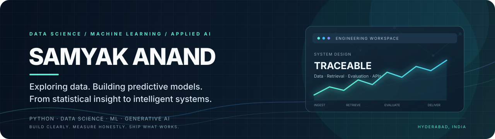

  

  

    <a href="https://samyak-anand-ai-scientist-portfolio.vercel.app/"><strong>PORTFOLIO</strong></a>
    &nbsp;·&nbsp;
    <a href="https://www.linkedin.com/in/samyakanand/"><strong>LINKEDIN</strong></a>
    &nbsp;·&nbsp;
    <a href="mailto:samyak.g.anand@gmail.com"><strong>EMAIL</strong></a>
    &nbsp;·&nbsp;
    <a href="https://github.com/SamyakAnand"><strong>GITHUB</strong></a>
  

  <h1>Samyak Anand</h1>
  <h3>Applied AI Engineer · Generative AI · Python & FastAPI</h3>
  
<em>Building practical AI applications with traceable retrieval, deterministic analytics, machine learning and reliable APIs.</em>

  

    <a href="#flagship-projects">Flagship projects</a> ·
    <a href="#engineering-toolkit">Engineering toolkit</a> ·
    <a href="#experience">Experience</a> ·
    <a href="#contact">Contact</a>
  

  
  
  

---

## About

I'm a Computer Science and Engineering graduate based in Hyderabad, India, focused on **Applied AI engineering**. I build practical applications that connect retrieval workflows, machine learning, deterministic data analysis, and Python backend services.

My engineering approach is evidence-led: keep calculations inspectable, preserve source context, validate structured outputs, and state clearly what a prototype does—and does not—implement.

## Flagship projects

<table>
  <tr>
    <td width="50%" valign="top">
      <h3>01 · NEXUS — Autonomous Data Analyst</h3>
      
Full-stack analytics prototype for CSV, JSON and XLSX ingestion, dataset profiling, question-driven deterministic analysis, anomaly checks, read-only SQL, previewable cleaning, run traces and report generation.

      
<strong>Stack:</strong> Python · FastAPI · Pandas · NumPy · SciPy · SQLite · Next.js · TypeScript

      
<a href="https://nexus-peach-six.vercel.app/">▶ Live demo</a> · <a href="https://github.com/SamyakAnand/NEXUS">Source code</a>

      Boundary: current local execution is deterministic and does not call an LLM. Production worker isolation and durable PostgreSQL persistence are not implemented.
    </td>
    <td width="50%" valign="top">
      <h3>02 · ARGUS AI — Evidence-Oriented Knowledge Workspace</h3>
      
Local-first Markdown and UTF-8 text knowledge workspace with passage indexing, lexical retrieval, exact source offsets, QA APIs and optional answer synthesis.

      
<strong>Stack:</strong> Python · FastAPI · SQLite · Next.js · React · TypeScript

      
<a href="https://argus-ai-iota.vercel.app/">▶ Live demo</a> · <a href="https://github.com/SamyakAnand/Argus-Ai">Source code</a>

      Boundary: synthesis is disabled by default; citation checks validate passage IDs, not semantic entailment.
    </td>
  </tr>
  <tr>
    <td width="50%" valign="top">
      <h3>03 · SHIRO CodeMind — Source-Grounded Code Intelligence</h3>
      
Repository exploration workspace that imports public GitHub repositories as indexed snapshots, supports source browsing and parser-derived import relationships, and grounds answers in file/line references.

      
<strong>Stack:</strong> Python · SQLite · GitHub API · TypeScript

      
<a href="https://github.com/SamyakAnand/Shiro-Ai">Source code</a>

      Hosted authentication and production multi-user controls should be verified separately before being described as production-ready.
    </td>
    <td width="50%" valign="top">
      <h3>04 · L — LLM Intelligence & Evaluation Platform</h3>
      
Early-stage, local-first platform for repeatable LLM experiments, prompt comparisons, evaluation workflows, regression analysis and trace inspection.

      
<strong>Stack:</strong> Next.js · TypeScript · Python · FastAPI

      
<a href="https://github.com/SamyakAnand/L-Intelligence-Platform">Source code</a>

      Boundary: live provider integrations, production authentication, credential storage and background workers are not yet implemented.
    </td>
  </tr>
  <tr>
    <td width="50%" valign="top">
      <h3>05 · Disease Predictor — Multi-Disease ML System</h3>
      
Modular machine-learning workflows for five disease categories, covering data ingestion, schema validation, transformation, training, drift reporting and a Flask prediction interface.

      
<strong>Stack:</strong> Python · Flask · Scikit-learn · MongoDB · MLflow · DagsHub

      
<a href="https://disease-predictor-dvty.onrender.com/">▶ Live demo</a> · <a href="https://github.com/SamyakAnand/Disease-Predictor">Source code</a>

    </td>
    <td width="50%" valign="top">
      <h3>06 · AI Resume Analyzer & Matcher</h3>
      
Collaborative NLP application for PDF/DOCX resume extraction, job-description matching, skill overlap, semantic similarity and weighted candidate scoring.

      
<strong>Stack:</strong> Python · Flask · NLTK · Scikit-learn · Sentence Transformers

      
<a href="https://github.com/SamyakAnand/Resume-Analyzer">Source code</a>

    </td>
  </tr>
</table>

### More engineering work

- [AKATSUKI AI](https://github.com/SamyakAnand/Akatsuki) — experimental local workflow prototype exploring persisted missions, conversations, typed handoffs, artifact records and a bounded deterministic routine.
- [Network Security](https://github.com/SamyakAnand/NetworkSecurity) — machine-learning pipeline project.
- [Student Performance Indicator](https://github.com/SamyakAnand/Student-Performance-Indicator) — regression workflow and Flask prediction interface.
- [Cars24 Web Scraping](https://github.com/SamyakAnand/Car24_Webscraping_project) — automotive listing data collection project.

### Business intelligence & analytics

- [Financial Risk Analytics](https://github.com/SamyakAnand/Financial-Risk-Analytics-Dashboard-End-to-End-Power-BI-Project)
- [Credit Card Analytics](https://github.com/SamyakAnand/Credit-Card-Analytics-Dashboard-Power-BI-)
- [Blinkit Sales & Inventory Analytics](https://github.com/SamyakAnand/Blinkit-Sales-Inventory-Analytics-Dashboard-End-to-End-Power-BI-Project)
- [Insurance Data Analysis](https://github.com/SamyakAnand/Insurance-Data-Analysis)
- [Netflix Dashboard](https://github.com/SamyakAnand/Netflix-Dashboard-in-Power-BI)
- [Amazon Prime Video Dashboard](https://github.com/SamyakAnand/Amazon-Prime-Video-Dashboard-in-Power-BI-)

---

## Engineering toolkit

  

| Domain | Skills |
|---|---|
| Applied AI | LLM application development, prompt engineering, retrieval workflows, lexical passage retrieval, source-grounded QA, structured tool calling, agent concepts, evaluation and citation checks |
| Programming | Python, SQL, Java, C, R, JavaScript, TypeScript |
| ML & NLP | Scikit-learn, TensorFlow, Keras, PyTorch, NLTK, Sentence Transformers, feature engineering, regression, classification, model evaluation |
| Data & BI | Pandas, NumPy, SciPy, EDA, statistics, Matplotlib, Seaborn, Power BI, DAX, Tableau, Advanced Excel, Power Query |
| Backend & web | FastAPI, Flask, REST APIs, Pydantic, Next.js, React, HTML5, CSS3 |
| Data stores | PostgreSQL, MySQL, SQLite, MongoDB |
| MLOps & delivery | MLflow, DVC, DagsHub, Docker, GitHub Actions, Vercel, Render |

I distinguish tools used in documented projects from technologies I am continuing to learn. I do not claim production expertise based only on familiarity.

## Experience

**Data Science Trainer · Softgrowth Infotech**  
October 2025 – November 2026 · Hyderabad, India

- Mentored **100+ learners** in Python programming, Data Science, Machine Learning and practical analytics.
- Guided **5+ postgraduate project teams** through problem definition, technical architecture, implementation, documentation and presentations.
- Delivered practical instruction in preprocessing, EDA, statistical analysis, ML algorithms and technical problem solving.

*Engagement concluded 9 November 2026.*

**Data Scientist Intern (Team Lead) · Evoastra Ventures Inc.**  
June 2025 – August 2025 · Remote

- Led a team of five interns on applied Data Science and ML projects.
- Built CARS24 listing data-collection workflows and contributed to NLP-based resume analysis.

**Data Science & Machine Learning Intern · Gilbert Research Center**  
March 2024 – July 2024 · Remote

- Worked with clinical datasets, modular ingestion/validation/transformation workflows and model training.
- Used MLflow and DagsHub for experiment tracking and artifact management.

## Education

- **B.Tech, Computer Science & Engineering** — Ballarpur Institute of Technology, 2024 · CGPA 6.69/10
- **Diploma, Computer Science** — Bajaj College of Polytechnic, 2021 · 84.25%

## Contact

- **Portfolio:** [samyak-anand-ai-scientist-portfolio.vercel.app](https://samyak-anand-ai-scientist-portfolio.vercel.app/)
- **LinkedIn:** [linkedin.com/in/samyakanand](https://www.linkedin.com/in/samyakanand/)
- **GitHub:** [github.com/SamyakAnand](https://github.com/SamyakAnand)
- **Resume:** [View PDF](https://samyak-anand-ai-scientist-portfolio.vercel.app/resume.pdf)
- **Email:** [samyak.g.anand@gmail.com](mailto:samyak.g.anand@gmail.com)
- **Location:** Hyderabad, Telangana, India

  Build clearly. Measure honestly. Ship what works.

