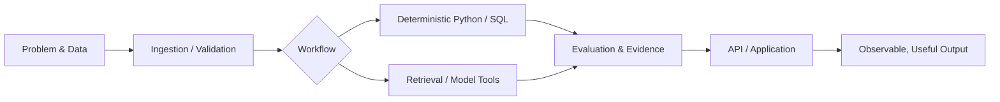

  

  <h1>Samyak Anand</h1>
  <h3>Data Scientist · Applied AI Engineer · Machine Learning · Generative AI</h3>
  
<em>Data Science is my foundation; Applied AI is where I extend it into intelligent, useful software.</em>

  

  

    <a href="https://samyak-anand-ai-scientist-portfolio.vercel.app/"><strong>✦ Portfolio</strong></a>
    &nbsp;·&nbsp;
    <a href="https://samyak-anand-ai-scientist-portfolio.vercel.app/resume.pdf"><strong>Resume</strong></a>
    &nbsp;·&nbsp;
    <a href="https://www.linkedin.com/in/samyakanand/"><strong>LinkedIn</strong></a>
    &nbsp;·&nbsp;
    <a href="mailto:samyak.g.anand@gmail.com"><strong>Email</strong></a>
  

  

    
    
    
  

  

---

## About

I'm a Computer Science and Engineering graduate based in **Hyderabad, India**, with a strong foundation in **Data Science, Machine Learning and Analytics**, and a growing specialization in **Applied AI Engineering**. Data Science is a part of my professional identity that I'm proud of: understanding data, finding patterns, building predictive models, communicating insights and turning analysis into decisions. I also build practical AI applications such as evidence-oriented knowledge tools, source-grounded code exploration and Python-backed intelligent workflows.

My approach is practical and evidence-led:

- Build the smallest useful workflow, then make it observable and testable.
- Keep numeric analysis deterministic where correctness matters.
- Make retrieval and generated answers traceable to source material.
- Document current limitations instead of presenting prototypes as production systems.

**Professional impact:** mentored **100+ learners** in Python, Data Science and Machine Learning, and guided **5+ postgraduate academic project teams** through technical implementation, documentation and presentations.

## What I work on

| Focus | Practical areas |
|---|---|
| **Data Science & Analytics** | Data preprocessing, EDA, statistics, hypothesis-driven analysis, visualization, analytical reporting, KPI development |
| **Machine Learning** | Classification, regression, feature engineering, predictive analytics, model evaluation, drift reporting |
| Applied AI & LLM apps | LLM application development, prompt engineering, retrieval workflows, source-grounded QA, structured tool calling, citation checks |
| Backend engineering | Python, FastAPI, Flask, REST APIs, Pydantic, SQL |
| Product development | Next.js, React, TypeScript, interactive web applications |
| ML engineering | MLflow, DVC, DagsHub, Docker, GitHub Actions, reproducible workflows |

---

## Featured projects

The projects below represent both sides of my work: Data Science / Machine Learning and Applied AI engineering. I value the full journey from understanding data and building models to creating useful intelligent applications. Demo links are included where a hosted application is available.

<table>
  <tr>
    <td width="50%" valign="top">
      <h3>01 · NEXUS — Autonomous Data Analyst</h3>
      
      
      
<b>Python · FastAPI · Pandas · NumPy · SciPy · SQLite · Next.js · TypeScript</b>

      
A full-stack analytics prototype for exploring structured datasets through inspectable, question-driven workflows.

      <ul>
        <li>CSV, JSON and XLSX ingestion, schema checks and profiling.</li>
        <li>Deterministic statistical analysis, anomaly checks and read-only SQL over isolated datasets.</li>
        <li>Previewable cleaning operations, execution traces and evidence-linked findings.</li>
        <li>Report generation and deterministic evaluation fixtures.</li>
      </ul>
      <b>Engineering boundary:</b> the current local analytical path does not itself call an LLM. Production worker isolation, durable multi-user storage and LLM synthesis are separate future work.
    </td>
    <td width="50%" valign="top">
      <h3>02 · ARGUS AI — Evidence-Oriented Knowledge Workspace</h3>
      
      
      
<b>Python · FastAPI · Next.js · React · TypeScript · SQLite</b>

      
A local-first document knowledge workspace designed to preserve the link between retrieved passages and their source text.

      <ul>
        <li>Markdown and UTF-8 text ingestion with passage indexing.</li>
        <li>Lexical passage retrieval with exact source offsets.</li>
        <li>Knowledge QA APIs with optional answer synthesis.</li>
        <li>Citation-ID validation and evaluation fixtures.</li>
      </ul>
      <b>Engineering boundary:</b> the documented retrieval path is lexical retrieval over locally indexed text—not a production dense-vector RAG service. Citation-ID checks confirm reference existence, not semantic entailment.
    </td>
  </tr>
  <tr>
    <td width="50%" valign="top">
      <h3>03 · SHIRO CodeMind — Source-Grounded Code Intelligence</h3>
      
      
<b>Python · SQLite · GitHub API · TypeScript</b>

      
A codebase exploration workspace for importing public repositories and navigating code with source context.

      <ul>
        <li>Imports public GitHub repositories as indexed snapshots.</li>
        <li>Source browsing and parser-derived import relationships.</li>
        <li>Repository Q&A and reusable learning artifacts.</li>
        <li>Validated file and line references for inspection.</li>
      </ul>
      <b>Engineering boundary:</b> hosted OAuth, Supabase row-level security and production deployment behaviour should be independently verified before being described as production-proven.
    </td>
    <td width="50%" valign="top">
      <h3>04 · Disease Predictor — Multi-Disease ML System</h3>
      
      
      
<b>Python · Flask · Scikit-learn · MongoDB · MLflow · DagsHub</b>

      <ul>
        <li>Machine-learning workflows for heart disease, breast cancer, kidney disease, liver disease and diabetes.</li>
        <li>Data ingestion, schema validation, transformation and model training.</li>
        <li>Data drift reporting and experiment tracking with MLflow / DagsHub.</li>
        <li>Flask-based prediction interface.</li>
      </ul>
      <b>Note:</b> this is an educational ML project, not a medical diagnostic service.
    </td>
  </tr>
  <tr>
    <td width="50%" valign="top">
      <h3>05 · L — LLM Intelligence & Evaluation Platform</h3>
      
      
<b>Early-stage prototype · Next.js · TypeScript · Provider-independent architecture</b>

      <ul>
        <li>Designed a local-first architecture for repeatable LLM experiments.</li>
        <li>Specified prompt comparison, evaluation workflows and regression analysis.</li>
        <li>Documented product requirements, architecture and security considerations.</li>
      </ul>
      <b>Engineering boundary:</b> provider-backed benchmarking and production integrations are not represented as completed features.
    </td>
    <td width="50%" valign="top">
      <h3>06 · AI Resume Analyzer & Matcher</h3>
      
      
<b>Python · Flask · NLTK · Scikit-learn · Sentence Transformers</b>

      <ul>
        <li>PDF/DOCX extraction and job-description matching.</li>
        <li>Skill overlap and semantic similarity analysis.</li>
        <li>Weighted candidate scoring and resume screening workflow.</li>
      </ul>
      Collaborative project work.
    </td>
  </tr>
</table>

### More live work · Data Science & Machine Learning

<table>
  <tr>
    <td width="50%" valign="top">
      <h3>07 · Student Academic Performance Predictor</h3>
      
      
      
<b>Python · Scikit-learn · Regression · Feature Engineering</b>

      
An end-to-end predictive modelling project for estimating student academic performance from structured demographic and socioeconomic features.

    </td>
    <td width="50%" valign="top">
      <h3>08 · Network Security Anomaly Pipeline</h3>
      
      
<b>Python · Scikit-learn · MongoDB · ML Pipelines</b>

      
A modular machine-learning workflow for network telemetry, preprocessing, anomaly detection and structured experiment outputs.

    </td>
  </tr>
</table>

[Browse all portfolio case studies and project demos →](https://samyak-anand-ai-scientist-portfolio.vercel.app/)

---

### Data Science & Business Intelligence portfolio

Data Science is not a side note in my profile—it is a core part of my training, experience and project work. Alongside AI application engineering, I continue to build analytical workflows, predictive models and business intelligence dashboards.

| Project | Focus | Repository |
|---|---|---|
| Network Security ML Pipeline | Network telemetry, anomaly detection and machine-learning workflow | [GitHub](https://github.com/SamyakAnand/NetworkSecurity) |
| Student Performance Indicator | Regression, preprocessing and academic performance analysis | [GitHub](https://github.com/SamyakAnand/Student-Performance-Indicator) |
| Disease Predictor | Five-category predictive modelling and ML experiment tracking | [GitHub](https://github.com/SamyakAnand/Disease-Predictor) |
| Financial Risk Analytics | Financial data analysis and Power BI reporting | [GitHub](https://github.com/SamyakAnand/Financial-Risk-Analytics-Dashboard-End-to-End-Power-BI-Project) |
| Credit Card Analytics | Customer and credit-card metrics, DAX and dashboards | [GitHub](https://github.com/SamyakAnand/Credit-Card-Analytics-Dashboard-Power-BI-) |
| Blinkit Sales & Inventory | Retail sales, inventory and business performance analytics | [GitHub](https://github.com/SamyakAnand/Blinkit-Sales-Inventory-Analytics-Dashboard-End-to-End-Power-BI-Project) |
| Insurance Data Analysis | Insurance analytics and reporting | [GitHub](https://github.com/SamyakAnand/Insurance-Data-Analysis) |

My BI work includes **SQL, Power Query, DAX, Excel, data transformation, dimensional modelling, KPI development and dashboard storytelling** across financial risk, insurance, credit cards, retail and streaming content.

---

### More engineering and analytics work

  
<strong>Machine learning, data science and BI projects</strong>

  - [Network Security ML Pipeline](https://github.com/SamyakAnand/NetworkSecurity) — machine-learning workflow for network security telemetry.
  - [Student Performance Indicator](https://github.com/SamyakAnand/Student-Performance-Indicator) — regression workflow for academic performance data.
  - [Cars24 Data Collection](https://github.com/SamyakAnand) — automotive listings collection and analysis work from internship experience.
  - [Insurance Data Analysis](https://github.com/SamyakAnand/Insurance-Data-Analysis)
  - [Credit Card Analytics Dashboard](https://github.com/SamyakAnand/Credit-Card-Analytics-Dashboard-Power-BI-)
  - [Financial Risk Analytics Dashboard](https://github.com/SamyakAnand/Financial-Risk-Analytics-Dashboard-End-to-End-Power-BI-Project)
  - [Blinkit Sales & Inventory Analytics](https://github.com/SamyakAnand/Blinkit-Sales-Inventory-Analytics-Dashboard-End-to-End-Power-BI-Project)
  - [Live API Data Integration](https://github.com/SamyakAnand/Live-API-Data-Integration-Real-Time-Dashboards-with-Python-Power-BI-)

  BI work includes data transformation, SQL analysis, Power Query, DAX measures, dimensional modelling and dashboard development across financial risk, insurance, credit cards, retail and streaming content.

  
<strong>AKATSUKI AI — Multi-Agent Workflow Prototype</strong>

  **Python · SQLite**

  - Prototyped persisted missions, conversations, typed handoffs and artifact history.
  - Explored workflow state and collaboration timelines.
  - Includes a deterministic local unit-conversion routine.

  **Current boundary:** experimental local prototype; no external LLM provider or production agent sandbox is connected.

  [Explore AKATSUKI AI →](https://github.com/SamyakAnand/Akatsuki)

---

## Technical toolkit

  <h3>Languages</h3>
  

  <h3>AI · Machine Learning · Data</h3>
  

  <h3>Backend · Frontend · Databases</h3>
  

  <h3>Engineering · Delivery</h3>
  

| Domain | Skills |
|---|---|
| Applied AI | LLM application development, prompt engineering, retrieval workflows, lexical retrieval, source-grounded QA, structured tool calling, citation verification, AI agent concepts |
| Machine learning | Scikit-learn, TensorFlow, Keras, PyTorch, NLTK, Sentence Transformers, regression, classification, feature engineering, model evaluation |
| Data science & analytics | Pandas, NumPy, SciPy, EDA, statistical analysis, Matplotlib, Seaborn, data visualization, KPI development, analytical reporting |
| Backend | Python, FastAPI, Flask, REST APIs, Pydantic |
| Frontend | Next.js, React, TypeScript, JavaScript, HTML5, CSS3 |
| Databases | PostgreSQL, MySQL, SQLite, MongoDB |
| Business intelligence | Power BI, Tableau, Advanced Excel, Power Query, DAX, data modelling, dashboard development, KPI analysis |
| MLOps & delivery | MLflow, DVC, DagsHub, Docker, Git, GitHub Actions, Vercel, Render |

I distinguish technologies used in documented projects from tools I am continuing to learn. Familiarity does not automatically imply production expertise.

---

## Professional experience

### Data Science Trainer · Softgrowth Infotech
**October 2025 – November 2026 · India**

- Mentored **100+ learners** in Python programming, Data Science, Machine Learning and practical data analytics.
- Guided **5+ postgraduate academic project teams** through problem definition, technical architecture, implementation, documentation and presentations.
- Delivered practical instruction in data preprocessing, EDA, statistics, machine-learning algorithms and technical problem-solving.

*Engagement concluded 9 November 2026.*

### Data Scientist Intern (Team Lead) · Evoastra Ventures Inc.
**June 2025 – August 2025 · Remote**

- Led a collaborative team of five interns working on applied Data Science and Machine Learning projects.
- Developed data collection and web-scraping workflows for automotive market analysis using CARS24 listings.
- Contributed to NLP-based recruitment and resume analysis, including text processing, skill matching, feature engineering and analytical reporting.

### Data Science & Machine Learning Intern · Gilbert Research Center
**March 2024 – July 2024 · Remote**

- Analyzed clinical healthcare datasets using statistical techniques and machine-learning algorithms.
- Developed modular workflows for data ingestion, validation, transformation and model training.
- Used MLflow and DagsHub for experiment tracking and artifact management; supported model evaluation and technical documentation.

---

## Education

| Qualification | Institution | Result |
|---|---|---|
| B.Tech — Computer Science & Engineering (2021–2024) | Ballarpur Institute of Technology, Maharashtra | 6.69 / 10 CGPA |
| Diploma — Computer Science (2018–2021) | Bajaj College of Polytechnic, Chandrapur | 84.25% |

## Certifications & professional development

- Full Stack Data Science and AI — Naresh IT, Hyderabad.
- Data Science and Machine Learning: Basic to Advanced — Udemy.
- Intermediate Machine Learning — Kaggle.
- Introduction to Machine Learning — Kaggle.
- Feature Engineering — Kaggle.
- Pandas, Data Visualization and Data Cleaning — Kaggle.
- Essential Java Course — CADD.
- Data Scientist Internship Credential — Evoastra Ventures Inc.
- Data Science & Machine Learning Research Completion — Gilbert Research Center.

---

## Data Science to Applied AI: my engineering approach

My process starts with the data and the problem: understand the question, inspect and prepare the data, analyse patterns or train and evaluate a model, then communicate the result clearly. When the problem calls for it, I extend that foundation into retrieval, LLM workflows and software applications. I aim for work that is reproducible, explainable and honest about its limitations.

## GitHub activity

  
  
   
  

---

## Connect

  
  
  
  

  
Build clearly. Measure honestly. Ship what works.

