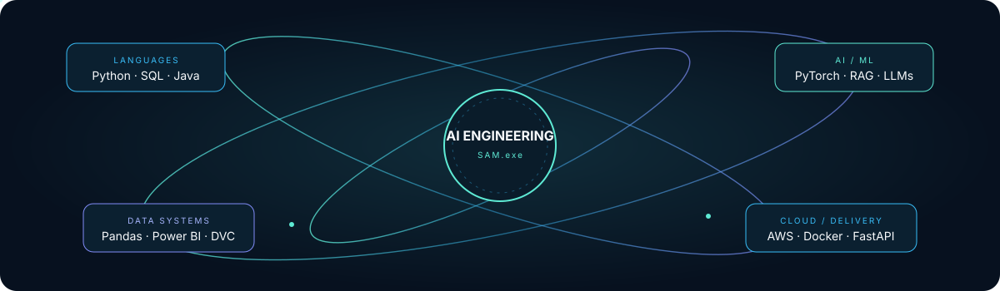
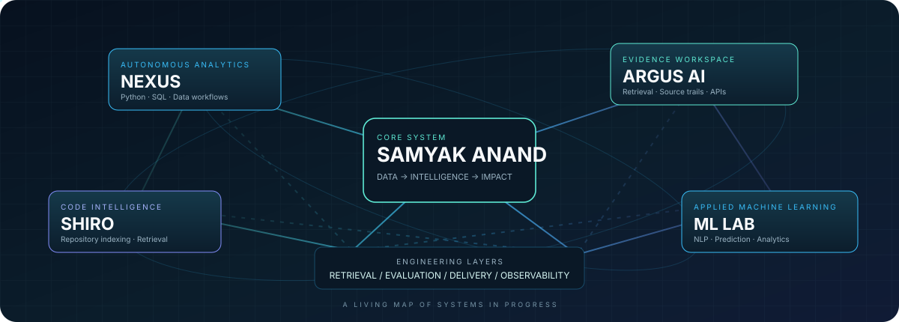
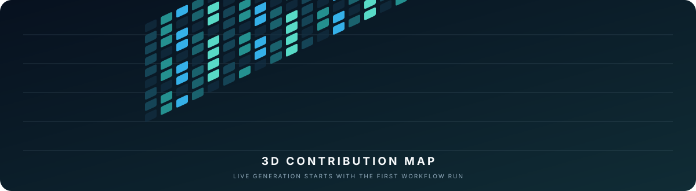

  

  

    
    
    
  

  <h3>AI Engineer · Machine Learning Engineer · Data Scientist · Data Analyst</h3>
  
<em>I turn data, models, and modern AI into useful products, reliable workflows, and decisions people can trust.</em>

  
  

---

## About

I'm **Samyak Anand**, a Computer Science graduate and Data Science Trainer building across **AI engineering, applied machine learning, data science, and analytics**.

I enjoy working end to end: understanding a problem, preparing and analyzing data, building models or retrieval workflows, exposing capabilities through APIs, and delivering a usable product.

- **Based in:** Hyderabad, India
- **Current role:** Data Science Trainer — Softgrowth Infotech
- **Education:** B.Tech, Computer Science & Engineering
- **Portfolio:** [samyak-anand.vercel.app](https://samyak-anand.vercel.app/)
- **LinkedIn:** [linkedin.com/in/samyakanand](https://www.linkedin.com/in/samyakanand/)

### Roles and areas

**AI Engineer · Applied AI Engineer · GenAI / RAG Engineer · Machine Learning Engineer · Data Scientist · Data Analyst · Python Backend Engineer**

I bring these areas together through Python, SQL, machine learning, LLM applications, data visualization, and practical software engineering.

## Project universe

  
  Projects connected by a common goal: turn complex information into useful, verifiable outcomes.

## Featured projects

<table>
  <tr>
    <td width="50%" valign="top">
      <h3><a href="https://github.com/SamyakAnand/NEXUS">NEXUS</a></h3>
      <strong>Autonomous Data Analyst</strong>
      
A data-analysis workflow that profiles datasets, plans analysis from a question, routes work to deterministic Python/SQL tools, validates outputs, and returns findings with an execution trace.

      Python · Pandas · SQL · Tool routing · Validation
    </td>
    <td width="50%" valign="top">
      <h3><a href="https://github.com/SamyakAnand/Argus-Ai">ARGUS AI</a></h3>
      <strong>Evidence-oriented knowledge workspace</strong>
      
A document intelligence workspace for indexing text, retrieving source passages, preserving evidence trails, and running a separate structured-data analytics workflow.

      FastAPI · Next.js · TypeScript · Retrieval · Evidence trails
    </td>
  </tr>
  <tr>
    <td width="50%" valign="top">
      <h3><a href="https://github.com/SamyakAnand/Shiro-Ai">SHIRO CodeMind</a></h3>
      <strong>Source-grounded code intelligence</strong>
      
Explores repository indexing, parser-derived imports, source-snapshot Q&amp;A, and study artifacts grounded in file-and-line references.

      Python · SQLite · Code indexing · Retrieval
    </td>
    <td width="50%" valign="top">
      <h3><a href="https://github.com/SamyakAnand/Resume-Analyzer">AI Resume Analyzer</a></h3>
      <strong>NLP-based resume matching</strong>
      
Parses PDF/DOCX resumes and compares them with job descriptions using semantic similarity, TF-IDF cosine similarity, and skill overlap.

      Python · Flask · NLP · Similarity scoring
    </td>
  </tr>
  <tr>
    <td width="50%" valign="top">
      <h3><a href="https://github.com/SamyakAnand/Student-Performance-Indicator">Student Performance Indicator</a></h3>
      <strong>End-to-end predictive ML</strong>
      
A regression workflow spanning ingestion, preprocessing, feature transformation, model training, prediction, and a Flask interface.

      Scikit-learn · Regression · Flask · Docker
    </td>
    <td width="50%" valign="top">
      <h3><a href="https://github.com/SamyakAnand/Credit-Card-Analytics-Dashboard-Power-BI-">Credit Card Analytics</a></h3>
      <strong>Business intelligence dashboard</strong>
      
Explores transaction revenue, interest, customer segments, spending patterns, payment modes, and risk dimensions through interactive reporting.

      Power BI · DAX · Power Query · Data modeling
    </td>
  </tr>
</table>

  
<strong>Explore more data science and analytics projects</strong>

   
  <a href="https://github.com/SamyakAnand/Financial-Risk-Analytics-Dashboard-End-to-End-Power-BI-Project">Financial Risk Analytics</a> ·
  <a href="https://github.com/SamyakAnand/Insurance-Data-Analysis">Insurance Data Analysis</a> ·
  <a href="https://github.com/SamyakAnand/Netflix-Dashboard-in-Power-BI">Netflix Dashboard</a> ·
  <a href="https://github.com/SamyakAnand/Amazon-Prime-Video-Dashboard-in-Power-BI-">Prime Video Dashboard</a> ·
  <a href="https://github.com/SamyakAnand/Blinkit-Sales-Inventory-Analytics-Dashboard-End-to-End-Power-BI-Project">Blinkit Sales &amp; Inventory</a> ·
  <a href="https://github.com/SamyakAnand/Car24_Webscraping_project">CARS24 Web Scraper</a> ·
  <a href="https://github.com/SamyakAnand/Amazon-Web-Scraping-Data-Analysis-project">Amazon Web Scraping</a> ·
  <a href="https://github.com/SamyakAnand/Live-API-Data-Integration-Real-Time-Dashboards-with-Python-Power-BI">Live API Data Integration</a> ·
  <a href="https://github.com/SamyakAnand/Disease-Predictor">Disease Predictor</a> ·
  <a href="https://github.com/SamyakAnand/NetworkSecurity">Network Security</a>

## Engineering toolkit

  **Programming &amp; data**
   
  

    
  **Machine learning &amp; AI**
   
  
   
  
  
  
  

    
  **Analytics, cloud &amp; delivery**
   
  
   
  
  
  
  
  
  

    
  Also exploring: LangChain · LangGraph · Streamlit · Supabase · Power Query · DAX · MLflow · DVC

## How I approach engineering

| Stage | What I focus on |
|---|---|
| **Understand** | Define the problem, users, success criteria, constraints, and data requirements. |
| **Prepare** | Validate inputs, inspect data quality, define schemas, and preserve lineage. |
| **Build** | Establish a transparent baseline; add models, retrieval, or orchestration where justified. |
| **Evaluate** | Test behavior, inspect errors, measure quality, and make limitations visible. |
| **Deliver** | Ship usable APIs, interfaces, dashboards, and reproducible documentation. |
| **Improve** | Monitor failures and iterate from evidence rather than assumptions. |

## Currently exploring

- **RAG &amp; knowledge systems:** retrieval quality, chunking, reranking, grounded generation, and citation validation.
- **Agentic AI:** tool use, workflow state, bounded autonomy, handoffs, and deterministic fallbacks.
- **AI evaluation:** test datasets, quality metrics, tracing, observability, and failure analysis.
- **Applied ML:** preprocessing, feature engineering, model selection, and error analysis.
- **Analytics engineering:** reliable SQL transformations, semantic models, KPI definitions, and actionable dashboards.

## Experience

**Data Science Trainer — Softgrowth Infotech**  
*October 2025 – Present*

- Mentor learners in data science concepts and practical workflows.
- Translate programming, analytics, and machine learning concepts into hands-on exercises.
- Support project-based learning and technical problem solving.

## GitHub activity

  
  
   
  

## 3D contribution landscape

  
  Generated by the repository's GitHub Actions workflow. Run it once from the Actions tab to replace the setup preview with live contribution data.

## Let's connect

I'm interested in meaningful opportunities and collaborations across **AI Engineering, Applied Machine Learning, GenAI, Data Science, and Analytics**.

  
  
  

   
  <strong>DATA → INTELLIGENCE → IMPACT</strong>
   
  Building practical systems that are useful, measurable, and explainable.

