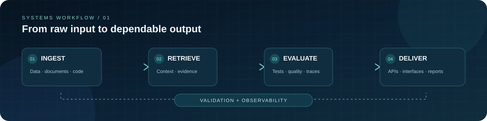

  

  

    <a href="https://samyak-anand.vercel.app/"><strong>PORTFOLIO</strong></a>
    &nbsp;·&nbsp;
    <a href="https://www.linkedin.com/in/samyakanand/"><strong>LINKEDIN</strong></a>
    &nbsp;·&nbsp;
    <a href="mailto:samyakanand2003@gmail.com"><strong>EMAIL</strong></a>
    &nbsp;·&nbsp;
    <a href="https://github.com/SamyakAnand"><strong>GITHUB</strong></a>
  

  <h1>Samyak Anand</h1>
  <h3>AI Engineer · Applied AI · Python Backend</h3>
  
<em>Engineering practical AI systems — from data and retrieval to reliable APIs and usable products.</em>

  

    <a href="#featured-work">Explore projects</a>
    &nbsp;·&nbsp;
    <a href="#engineering-toolkit">Tech stack</a>
    &nbsp;·&nbsp;
    <a href="#experience">Experience</a>
    &nbsp;·&nbsp;
    <a href="#contact">Contact</a>
  

  
  
  

---

<table>
  <tr>
    <td width="58%" valign="top">
      <h2>01 / The engineer</h2>
      
I'm a Computer Science graduate and Data Science Trainer at <strong>Softgrowth Infotech</strong> (October 2025–present), based in Hyderabad, India.

      
My work sits at the intersection of <strong>Python engineering, applied AI, data systems and product delivery</strong>. I like systems where the path from input to output is visible, testable and understandable.

      
I build around a simple principle: useful software should make its behaviour inspectable, its limitations explicit and its results reproducible.

    </td>
    <td width="42%" valign="top">
      <h2>02 / Current direction</h2>
      <ul>
        <li>Retrieval and source-grounded AI</li>
        <li>Reliable Python APIs and tool interfaces</li>
        <li>Evaluation, observability and failure handling</li>
        <li>Data workflows and analytical systems</li>
        <li>Taking prototypes toward deployable software</li>
      </ul>
    </td>
  </tr>
</table>

## 03 / How I think about systems

  

Make the data path visible. Keep the system bounded. Evaluate before making claims.

---

## 04 / Featured engineering work

Four projects, four distinct engineering questions. Maturity and unfinished work are described honestly in each overview.

<table>
  <tr>
    <td width="50%" valign="top">
      <h3>01 · NEXUS</h3>
      
<strong>Autonomous Data Analyst</strong>

      
Turn a question about a dataset into an inspectable analytical workflow.

      

        
      

      
<strong>Implemented</strong>

      <ul>
        <li>Local FastAPI + Next.js workflow</li>
        <li>CSV, JSON and XLSX profiling</li>
        <li>Read-only SQL over an isolated dataframe</li>
        <li>Preview-and-apply cleaning operations</li>
        <li>Run traces, chart-ready outputs and fixture-based evaluations</li>
      </ul>
      
<strong>Next engineering step</strong> Wire durable PostgreSQL persistence, add authentication and production worker isolation, then integrate and evaluate LLM synthesis.

      
Python · FastAPI · Pandas · SQL · Next.js · TypeScript

    </td>
    <td width="50%" valign="top">
      <h3>02 · ARGUS AI</h3>
      
<strong>Evidence-oriented knowledge workspace</strong>

      
Retrieve document passages and inspect the source material behind an answer.

      

        
      

      
<strong>Implemented</strong>

      <ul>
        <li>Local Markdown and UTF-8 text indexing</li>
        <li>Passage retrieval with source offsets</li>
        <li>Separate knowledge retrieval and legacy analytics areas</li>
        <li>Deterministic evaluation and optional answer synthesis</li>
      </ul>
      
<strong>Next engineering step</strong> Add semantic citation evaluation, complete authorization coverage, rate limiting and durable multi-tenant storage.

      
Python · FastAPI · Next.js · TypeScript · Retrieval

    </td>
  </tr>
  <tr>
    <td width="50%" valign="top">
      <h3>03 · SHIRO CodeMind</h3>
      
<strong>Source-grounded code intelligence</strong>

      
Explore a public repository through immutable snapshots, source browsing and file/line-grounded outputs.

      

        
      

      
<strong>Implemented</strong>

      <ul>
        <li>Public GitHub repository import as commit snapshots</li>
        <li>Source browsing and parser-derived import relationships</li>
        <li>Repository Q&amp;A and saved study artifacts</li>
        <li>Validated file and line references</li>
      </ul>
      
<strong>Next engineering step</strong> Verify hosted OAuth, Supabase row-level security, persistence and deployment limits end to end.

      
Python · SQLite · Supabase · GitHub API · Retrieval

    </td>
    <td width="50%" valign="top">
      <h3>04 · AKATSUKI AI</h3>
      
<strong>Multi-agent workflow prototype</strong>

      
A local mission desk exploring typed handoffs, persisted workflow state and collaboration history.

      

        
      

      
<strong>Implemented</strong>

      <ul>
        <li>Persisted missions, conversations and handoffs</li>
        <li>Artifact records and collaboration timeline</li>
        <li>Deterministic local unit-conversion routine</li>
      </ul>
      
<strong>Current boundary</strong> Experimental prototype. No LLM provider, external research service, general-purpose coding agent or production worker sandbox is connected.

      
Python · SQLite · Workflow orchestration

    </td>
  </tr>
</table>

  
<strong>How to evaluate these projects</strong> — scope, maturity and evidence

   
  <ul>
    <li><strong>Start with the README:</strong> architecture, setup instructions and documented limitations.</li>
    <li><strong>Inspect the implementation:</strong> API boundaries, persistence, validation, error handling and tests.</li>
    <li><strong>Run the project:</strong> use the repository's documented local setup and verify the behaviour yourself.</li>
    <li><strong>Check the claims:</strong> I avoid presenting a prototype as production software or reporting performance numbers without reproducible measurements.</li>
  </ul>

---

## 05 / Engineering toolkit

<table>
  <tr>
    <td width="25%" valign="top"><strong>AI &amp; retrieval</strong></td>
    <td>LLM application patterns · Retrieval workflows · Source grounding · Structured outputs · Evaluation</td>
  </tr>
  <tr>
    <td valign="top"><strong>Backend</strong></td>
    <td>Python · FastAPI · REST APIs · Validation · SQL · Persistence</td>
  </tr>
  <tr>
    <td valign="top"><strong>Data &amp; ML</strong></td>
    <td>Pandas · NumPy · scikit-learn · Data profiling · Statistical analysis</td>
  </tr>
  <tr>
    <td valign="top"><strong>Frontend</strong></td>
    <td>Next.js · React · TypeScript</td>
  </tr>
  <tr>
    <td valign="top"><strong>Engineering practice</strong></td>
    <td>Git · GitHub Actions · Docker · Automated tests · Execution traces</td>
  </tr>
</table>

  
  
  
  
  
  
  
  
  

I prefer to demonstrate a technology through a working repository rather than list tools I have only experimented with.

---

## 06 / Experience &amp; education

<table>
  <tr>
    <td width="22%" valign="top"><strong>OCT 2025 — PRESENT</strong></td>
    <td valign="top">
      <strong>Data Science Trainer · Softgrowth Infotech</strong> 
      Hyderabad, India
      <ul>
        <li>Mentor learners in data science concepts and practical workflows.</li>
        <li>Translate programming, analytics and machine learning topics into hands-on exercises.</li>
        <li>Support project-based learning and technical problem solving.</li>
      </ul>
    </td>
  </tr>
  <tr>
    <td valign="top"><strong>EDUCATION</strong></td>
    <td valign="top"><strong>B.Tech · Computer Science &amp; Engineering</strong> Computer Science graduate · 2024</td>
  </tr>
</table>

## 07 / Earlier work

  
<strong>Machine learning, NLP and analytics projects</strong> — expand project list

   
  - <a href="https://github.com/SamyakAnand/Resume-Analyzer">AI Resume Analyzer</a> — resume parsing and job-description matching using NLP and similarity methods.
  - <a href="https://github.com/SamyakAnand/Student-Performance-Indicator">Student Performance Indicator</a> — regression workflow with preprocessing, model training and a Flask interface.
  - <a href="https://github.com/SamyakAnand/Credit-Card-Analytics-Dashboard-Power-BI-">Credit Card Analytics Dashboard</a> — Power BI reporting for customer and transaction analysis.
  - <a href="https://github.com/SamyakAnand/Financial-Risk-Analytics-Dashboard-End-to-End-Power-BI-Project">Financial Risk Analytics</a> · <a href="https://github.com/SamyakAnand/Insurance-Data-Analysis">Insurance Data Analysis</a> · <a href="https://github.com/SamyakAnand/Blinkit-Sales-Inventory-Analytics-Dashboard-End-to-End-Power-BI-Project">Blinkit Sales &amp; Inventory</a>

---

  <h2>Let's build something useful.</h2>
  
Interested in AI Engineer, Applied AI Engineer and Python Backend Engineer opportunities.

  

    
    
    
  

  Build clearly. Measure honestly. Ship what works.

