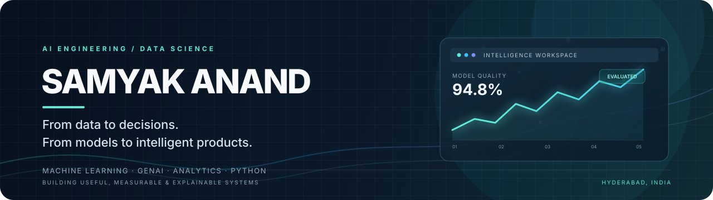

  

  

    <a href="https://samyak-anand.vercel.app/">Portfolio</a> ·
    <a href="https://www.linkedin.com/in/samyakanand/">LinkedIn</a> ·
    <a href="mailto:samyakanand2003@gmail.com">Email</a>
  

  <h3>AI Engineer · Applied AI · Python Backend</h3>
  
<em>I build practical AI-enabled software, from data and retrieval pipelines to APIs, evaluation and usable interfaces.</em>

---

## About

I'm **Samyak Anand**, a Computer Science graduate and Data Science Trainer at **Softgrowth Infotech** (October 2025–present), based in Hyderabad, India.

My current focus is **applied AI engineering**: building software around LLMs and retrieval, making workflows inspectable, and using deterministic code and evaluation where reliability matters.

I enjoy taking a problem from its data and system design through implementation, testing, API design and a usable interface.

## Selected engineering work

These are active portfolio projects at different maturity levels. Their status is stated plainly so you can judge what is implemented and what remains.

### [NEXUS — Autonomous Data Analyst](https://github.com/SamyakAnand/NEXUS)
**A deterministic analytics workflow with inspectable execution.**

- Profiles CSV, JSON and XLSX datasets, plans analysis from a question, selects Python/SQL/statistical tools and validates outputs.
- Returns findings with evidence, run traces and chart-ready results; includes preview-and-apply cleaning operations and a deterministic evaluation suite.
- **Implemented:** local FastAPI + Next.js workflow, file-backed run storage, read-only SQL over an isolated data frame and fixture-based evaluations.
- **Not production-ready yet:** PostgreSQL/Redis are provisioned but not wired into the API; LLM synthesis, multi-user authentication and production worker isolation are not implemented.

*Python · FastAPI · Pandas · SQL · Next.js · TypeScript*

### [ARGUS AI — Evidence-oriented knowledge workspace](https://github.com/SamyakAnand/Argus-Ai)
**Search documents and inspect the source passages behind an answer.**

- Indexes local Markdown/UTF-8 text, retrieves source passages and preserves source offsets.
- Separates document knowledge retrieval from a legacy structured-data analytics workspace.
- Includes a small deterministic evaluation suite and optional answer synthesis behind explicit configuration.
- **Current boundary:** development preview; citation-ID checks do not prove semantic entailment. Production identity lifecycle, rate limiting, durable multi-tenant storage and complete authorization coverage remain unfinished.

*Python · FastAPI · Next.js · TypeScript · Retrieval · Clerk*

### [SHIRO CodeMind — Source-grounded code intelligence](https://github.com/SamyakAnand/Shiro-Ai)
**Explore a public codebase with file-and-line grounded outputs.**

- Imports public GitHub repositories as immutable commit snapshots.
- Provides source browsing, parser-derived import relationships, repository Q&A and saved study artifacts with validated file/line references.
- Includes local SQLite mode and a hosted architecture using Supabase Auth, Postgres and row-level security.
- **Current boundary:** hosted deployment still requires end-to-end verification of OAuth, RLS isolation, persistence, environment configuration and function-time limits.

*Python · SQLite · Supabase · GitHub API · Retrieval*

### [AKATSUKI AI — Multi-agent workflow prototype](https://github.com/SamyakAnand/Akatsuki)
**A local mission desk exploring typed handoffs and workflow state.**

- Persists missions, member conversations, handoffs, artifacts and a collaboration timeline.
- Uses deterministic local routines for a narrow built-in unit-conversion task.
- **Current boundary:** no LLM provider, external research, general-purpose coding agent or production worker sandbox is connected. This is an experimental workflow prototype, not an autonomous production agent.

*Python · SQLite · Workflow orchestration*

## Engineering strengths

| Area | Practical focus |
|---|---|
| **Applied AI** | Retrieval workflows, source grounding, bounded tool use, structured outputs |
| **Backend engineering** | Python, FastAPI, API contracts, validation, persistence |
| **Data & ML** | Pandas, SQL, data profiling, scikit-learn, evaluation |
| **Frontend delivery** | Next.js, React, TypeScript |
| **Reliability** | Tests, deterministic fallbacks, execution traces, explicit limitations |
| **Developer workflow** | Git, GitHub Actions, Docker |

I prefer to show a technology through a working repository rather than list tools I have only experimented with.

## Experience

**Data Science Trainer — Softgrowth Infotech**  
*October 2025 – Present*

- Mentor learners in data science concepts and practical workflows.
- Turn programming, analytics and machine learning topics into hands-on exercises.
- Support project-based learning and technical problem solving.

**Education:** B.Tech, Computer Science & Engineering.

## Additional projects

A selection of earlier machine learning and analytics work:

- [AI Resume Analyzer](https://github.com/SamyakAnand/Resume-Analyzer) — resume parsing and job-description matching using NLP and similarity methods.
- [Student Performance Indicator](https://github.com/SamyakAnand/Student-Performance-Indicator) — end-to-end regression workflow with preprocessing, training and a Flask interface.
- [Credit Card Analytics Dashboard](https://github.com/SamyakAnand/Credit-Card-Analytics-Dashboard-Power-BI-) — Power BI reporting for customer and transaction analysis.
- [Financial Risk Analytics](https://github.com/SamyakAnand/Financial-Risk-Analytics-Dashboard-End-to-End-Power-BI-Project) · [Insurance Data Analysis](https://github.com/SamyakAnand/Insurance-Data-Analysis) · [Blinkit Sales & Inventory](https://github.com/SamyakAnand/Blinkit-Sales-Inventory-Analytics-Dashboard-End-to-End-Power-BI-Project)

## What I'm focused on now

- Improving retrieval quality, grounding and evaluation in knowledge systems.
- Building robust Python APIs and well-defined tool interfaces.
- Testing agent workflows for failure handling, observability and bounded autonomy.
- Turning prototypes into deployable software with clear security and operational boundaries.

## Contact

I'm interested in **AI Engineer, Applied AI Engineer and Python Backend Engineer** opportunities, especially teams building useful AI products.

- **Portfolio:** https://samyak-anand.vercel.app/
- **LinkedIn:** https://www.linkedin.com/in/samyakanand/
- **Email:** samyakanand2003@gmail.com

---

  Build clearly. Measure honestly. Ship what works.

